# Cable Car Through the Alps

**Cable Car Through the Alps** is a C++/OpenGL project developed by our team: it features an endlessly scrolling cable car ride through a snowy mountain landscape. The viewer can follow the cable car from several camera viewpoints, change the time of day, and adjust the lighting and materials live from a control panel. The scene is enhanced by an animated cable car (opening doors and turning wheels), a rope, falling snow and fog.

This report gives an overview of the implemented features, along with screenshots. Each team member's contribution is summarised, and described alongside the features they implemented.

The project applies the concepts taught in the lectures of 3D Computer Graphics and Animation. Knowledge from additional external sources is listed in the references.

## Team Members
| Feature | Contributors (Percentage Share) |
|---------|----------------------|
| Multiple View Points (Orbit, Top, Follow) | Shreya Balaji (100%)|
| PBR Shading | Shreya Balaji (100%) |
| Environment Mapping | Shreya Balaji ([60]%), Henrik Innos ([ ]%) |
| Day and Night (Light and Sky Settings) | Shreya Balaji (100%) |
| Cabin Lights | Shreya Balaji (100%) |
| Cable Car and Rope Shadow | Shreya Balaji (100%) |
| Material Textures and Lighting | Srinitish Ramesh (100%) |
| Cable Car Model Adjustments and Import | Srinitish Ramesh (100%) |
| Cable Path for Cable Car | Srinitish Ramesh (100%) |
| Minimap | Srinitish Ramesh (100%) |
| Mountain Import and Normal Mapping | Henrik Innos ([ ]%), Srinitish Ramesh ([ ]%) |
| | Henrik Innos ([ ]%) |

*Table 1: List of features and percentage contribution from each team member*

## Introduction

The demo is a real-time application written in C++ with OpenGL 4.1. It is built with CMake, and also uses ImGui for the control panel (to control all features from the UI) and Assimp to load the cable car model. 

The sections below describe the implemented features. The minimal features are described first, followed by the extra features. Each feature has a short explanation of the idea used to implement it and relevant screenshots to present the output. A table of all keys and sliders is given in *ImGui Controls*.

## Features
### Minimal features

#### Multiple View Points (Orbit View, Follow View, Top View, Bezier View, Free Camera)
The project uses multiple camera modes to follow the path of the cable car and also view the snowy terrain around it. 

##### Orbit View
This view (as depicted in Figure 1) is used to orbit around the cable car. This is controlled by yaw, pitch and distance which can control angle around the vertical axis, angle above the horizontal axis and radius of the orbit. Pitch is limited to -85 degrees to +85 degrees to ensure the view doesn't look down exactly and flip. The minimum distance is also kept at 2 units to ensure that we don't really go into the cable car.

  

*Figure 1: Orbit View*

##### Top View
The camera hangs about 12 units above the targeted cable car and looks straight down, which gives a top view. Figure 2 shows an overview of this. Also, GLM's lookAt computes the camera's right axis as the cross product of the looking direction and the up vector (0,1,0). If the camera looks exactly down, these two are parallel making the cross product zero; hence a small offset of 0.01 is added along z, which makes them slightly non-parallel without changing the view entirely.

  

*Figure 2: Top View*

##### Follow View
The camera basically follows the cable car along the rope; it keeps a fixed offset which is 2.5 units up and 8 units away along the z axis. This is depicted in Figure 3 below.

  

*Figure 3: Follow View*

#### Bezier View
The camera modes also include the Bezier View, which is elaborated under the Bezier Curves section.

#### Free Camera
By toggling Free Camera, you can move around the scene freely using WASD keys for movement. The free camera implementation is mostly copied from the shadow mapping homework assignment, with small changes to adapt it into the project. The previously mentioned camera angles are part of `AttachedCamera`. `CameraRig` handles switching between `AttachedCamera` and `FreeCamera`. To be able to observe the position of `AttachedCamera` from the free camera, we render an icon (`CameraIcon`), which shows the orientation and position of the attached camera (see Figure 4).

  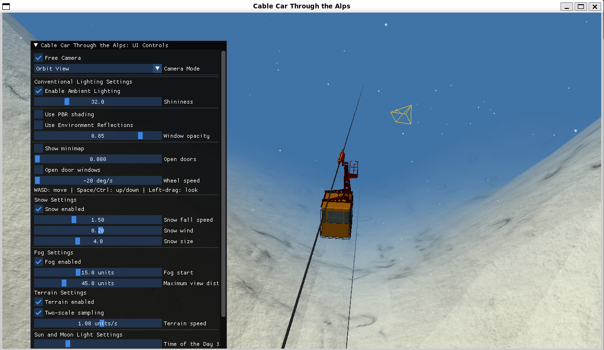

*Figure 4: Camera Icon*

#### Material Textures and Lighting
Material Textures and Lighting models are implemented in this demo to showcase how the body of Cable Car interacts with light. The diffuse coefficient **(kd)** and specular coefficient **(ks)** are used to showcase the base color and highlights of the model. **Shininess** is also integrated to determine the level of sharpness of these highlights.

To provide shading based on the angle in which light hits the surface, **Lambertian Diffuse Reflection** is used. To produce more realistic reflective surface **Blinn-Phong Specular reflection** is added. Finally, **Ambient Lighting** provides general illumination, ensuring that the surface is visible in areas that lack direct lighting. To test this, toggle **Enable Ambient Lighting** on and off to observe general illumination. Adjust the **Shininess** slider to see how specular highlights changes.

*Note:* These material, texture, and conventional lighting features are implemented to fulfill the assignment's minimal requirements. However, the team has decided to use **Physically Based Rendering (PBR)** with metallic and roughness, to visually enhance the cable car model.

  
  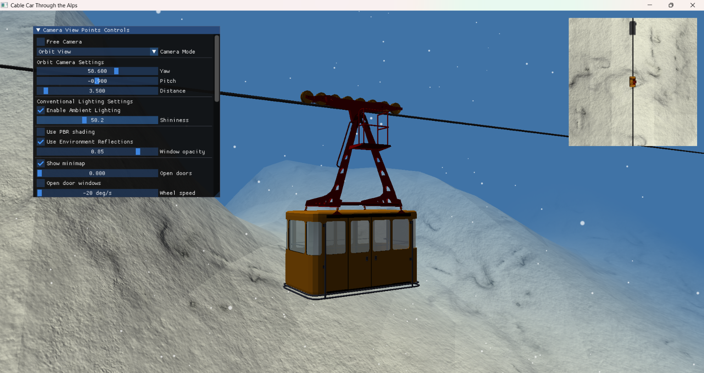

*Figure 5: Conventional Lighting Settings Not Enabled (left) and Conventional Lighting Settings Enabled (right)*

----

#### PBR Shading

When the PBR Shading is enabled, the body of cable car uses Cook-Torrance microfacet model instead of the Blinn-Phong shader. This is used to compute how much light is reflected off the surface. Two sliders are provided to control metallic and roughness. A dull highlight is given for high roughness; metallic value basically increases the ability's surface to display properties of a metal.

For all light sources (sun, moon and a cabin light in our case), a function is defined to compute the reflected light from the parts of the cable car. The computed value is added to the ambient term.

The Cook-Torrance microfacet model is implemented for this. Some external sources and lecture content were used to gain better understanding of this can be implemented and these are added in the reference.

* **D (GGX Distribution):** It controls how large and how sharp the shiny spot is. With low roughness, the cabin gets a small, bright, highlight and with high roughness, the highlight spreads into a dim and dull, matte surface.

* **G (Smith with Schlick-GGX):** It reduces the highlight where the surface is seen at a shallow angle; basically reduces light when viewed from a grazing angle.

* **F (Fresnel Term, Schlick approximation):** This gives surfaces more mirror-like appearance at grazing angles. On the cabin, this gives a brighter appearance along the edges and on surfaces seen from the side.

* **F0 (Base Reflectance):** This is indicative of how reflective the surface is when looked directly at it. As the metallic value increases, surface begins to look more like a metal because of this base reflectance value.

* **Specular Term:** This combines D, G and F (D · G · F / (4 · N·V · N·L)) into the shiny part of the surface, which is what gives the cabin its highlights and reflections. Because it uses all three terms, the highlight combines roughness, viewing angle and metallic value together, making the cabin look more metallic when metallic value is increased.

* **Diffuse Term:** This is the matte colour of the cabin and it is reduced by the Fresnel and the metallic value scaled by kD = (1 − F)(1 − metallic), so as the surface becomes more metallic it loses its matte colour and depends on its reflections, similar to what an actual metal does. It is also divided by π so the surface never reflects more light than it receives (energy conservation, but also makes the brightness realistic).

  
  

*Figure 6.The cable car with PBR shading off (left, Blinn-Phong) and on (right, metallic 0.25, roughness 0.25)*

  
  

*Figure 7. The cable car with metallic 0.00 / roughness 0.00 (left) and metallic 0.94 / roughness 0.57 (right)*

As it can be observed in Figure 6, with Blinn-Phong (left), the cabin roof and the red tower look bright and saturated. With PBR (right), the same surfaces look duller and darker. 

In Figure 7, the metallic and roughness values are slided from low to high. At the higher metallic value, the red tower loses its bright matte paint colour and looks darker. Since the diffuse term is lower, a metal shows only its reflections. With a metallic value of 0 and a roughness of 0, the surface keeps its full paint colour.

The two sliders change the look of the cable car in the way the model predicts: metallic controls how much matte colour remains, and roughness controls how wide and strong the highlight is. In these views the highlight is probably not very easy to see, because the cabin does not directly face the sun. Ensure to have fog disabled as well while running the application.

----

### Terrain and Normal Mapping
The terrain consists of 3 identical tiles in a row, which is being scrolled under the cable car. When the car surpasses 1 tile length from the center, it is moved back to the center (`Terrain::update`). Since the tiles are identical, the reset is seamless.

The terrain tile is generated using the `terrainMesh` function. The terrain tile is a grid with the dimensions `CELLS`x`CELLS`. The `terrainVertex` function translates a point on the grid into a world space position (a mesh vertex). The x and z coordinates are scaled by `TILE_SIZE` and the y coordinate is calculated as follows: 
1. convert the x and z coordinates into angles between 0 and 2π (use modulus so that coordinates match at the edges)
2. subtract 10 to so that the terrain is below the cable car
3. `ridge` ensures that there is a valley through the middle
4. `peaks` creates the mountains along the valley using a combination of sine and cosine functions. `peaks` is a linear blend of `leftPeaks` and `rightPeaks`, using the x coordinate, so that on the left side of the valley `leftPeaks` is more dominant, and on the right it's `rightPeaks`. 
5. add a sine function to vary the valley bed geometry.

The terrain is covered with a snowy texture [[9](https://polyhaven.com/a/snow_02)]. The snow consists of a diffuse texture and a normal map. Figure 8 shows the difference between rendering the terrain with and without the normal map. There is a problem with using just one texture repeated multiple times, that you can easily notice the repetition. To reduce repetition, we used two-scale texture blending [[10](https://www.versluis.com/2023/05/how-to-use-macro-variations-for-unreal-engine-landscape-materials/)]. In `basic.frag`, we define a `broadUV` coordinate, which scales at 25% speed and has an arbitrary offset. If two-scale texture blending is enabled, we create a mix, with 70% of the original sample and 30% of the broad sample. The same is done with the tangent normal. The difference blending makes can be seen in Figure 9. The downside of blending is that the texture loses some of its crispness and becomes more smooth. 

  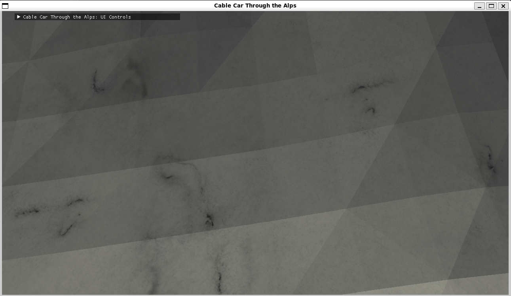
  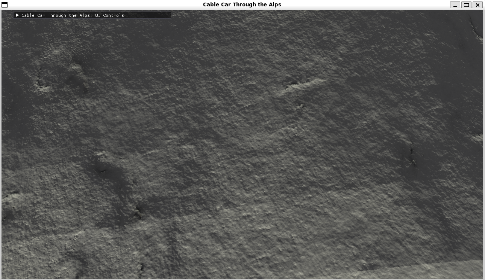

*Figure 8: Normal Mapping disbled (left) and enabled (right)*

  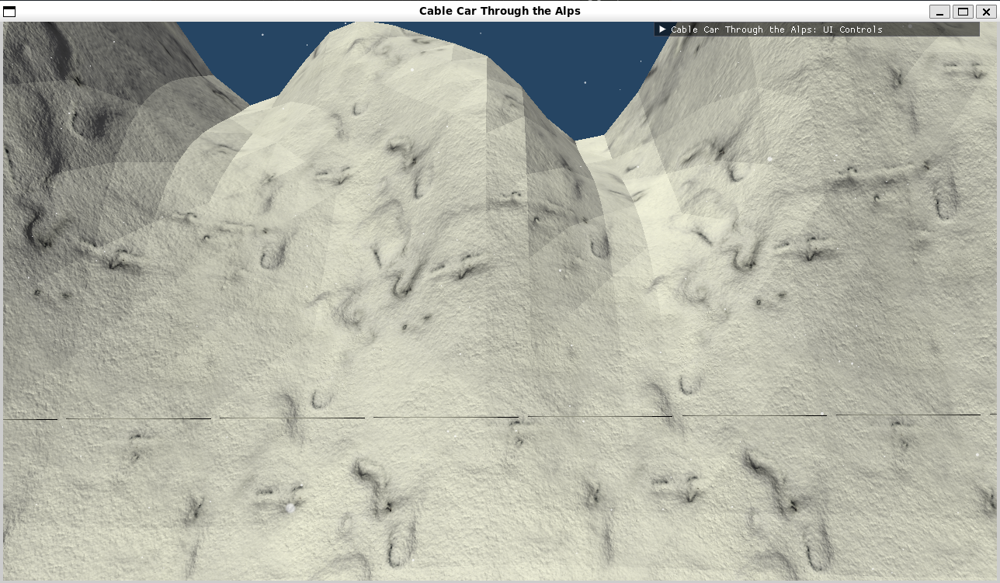
  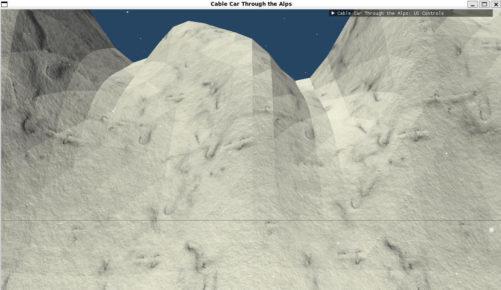

*Figure 9: Two-scale texture blending disabled (left) and enabled (right)*

### Environment Mapping
Environment mapping lets the cabin windows reflect their surroundings, a snowy terrain in our case. 
The basic idea is that the cabin takes a picture of sorts in all direction and each window shows a part of that picture that a surface like mirror would reflect towards the viewing direction. 
For our implementation, the sky and terrain is rendered six time in all directions into a cube map. A blurrier mip is also built from it for less shiny surfaces. For optimization purposes, the environment map is not updated every frame, but 20 times per second. The view direction is mirrored and then used to look up the cube map, which gives the colour of the reflected sky and terrain. Figure 10 depicts the environment mapping enabled and disabled scenarios in our application.  
The terrain part of the environment map is generated based on a simplified version of the terrain (`m_reflectionMesh`), with fewer cells and very basic shading (`m_reflectionShader`). Using a simplified mesh, however, created a pixelated reflection. To make it look better, we used PCF with a 3x3 filter kernel (see Figure 11). Finally, alpha blending is used to blend the reflection with what's visible behind the window. Window opacity is configurable in the GUI. 

  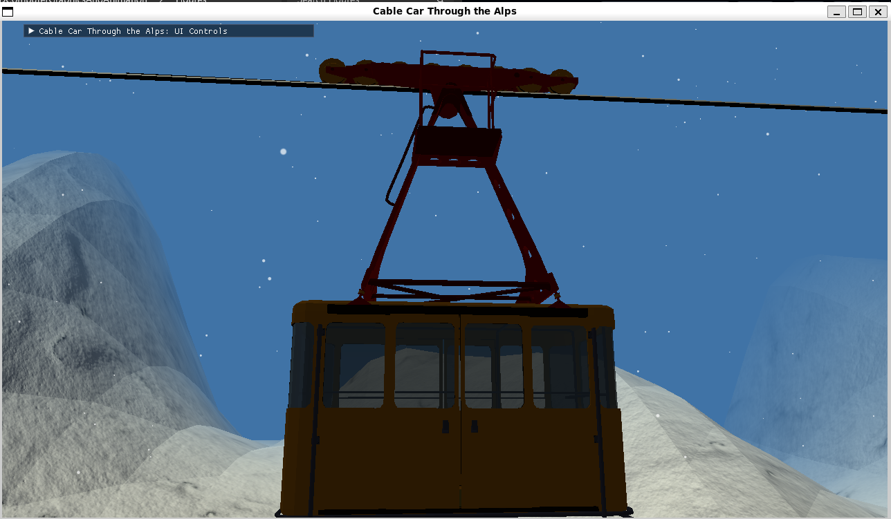
  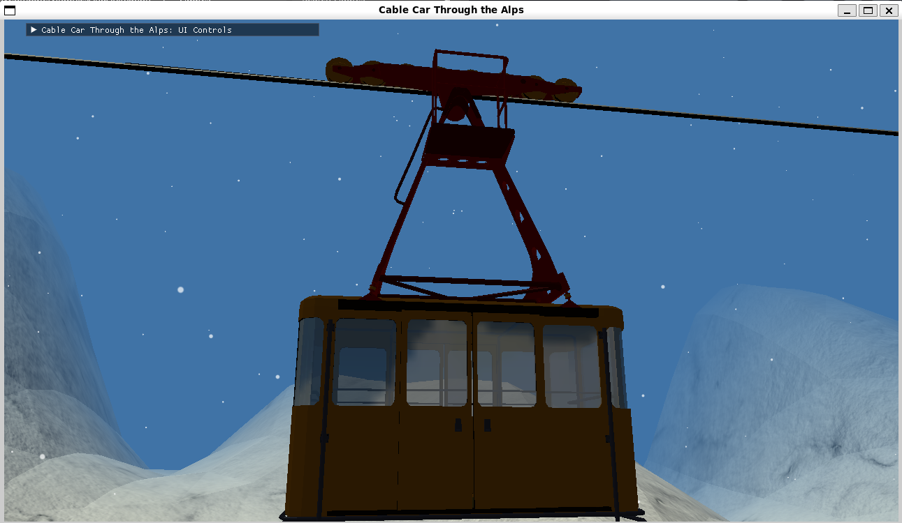

*Figure 10: Environment Mapping Disabled (left) and Environment Mapping Enabled (right)*

  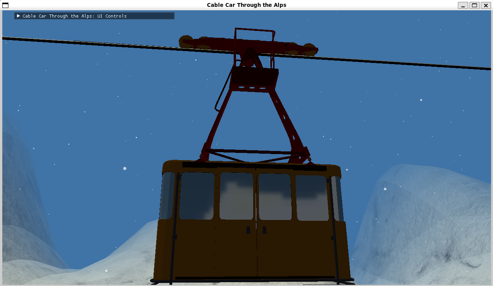
  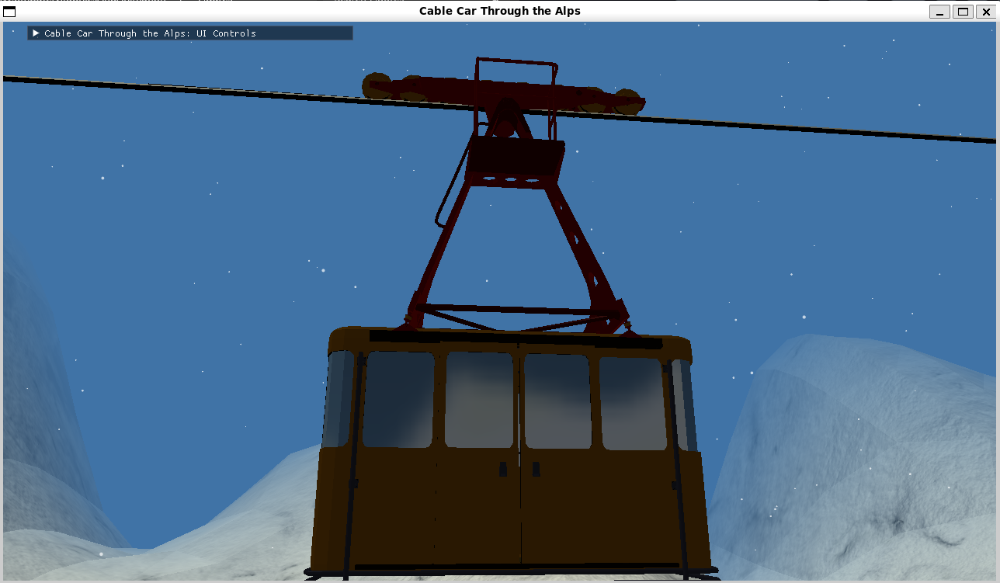

*Figure 11: PCF disabled (left) and PCF enabled (right) at maximum window opacity*

**Note:** The initial version of the environment mapping was applied to the whole cabin. Henrik later restricted it to the windows, reduced the capture rate, and added a lighter terrain draw for the capture.

### Bezier Curves

The project contains a class called `BezierCurve`, which represents a cubic Bezier curve. For simplicity, since the curves used here are not large, the curve always contains 100 segments. The class contains a function `evaluate`, which evaluates the curve at a specified t in (0,1), using the standard formula. The `draw` function draws the curve using `GL_LINE_STRIP`.  
There is also `CompositeBezierCurve`, which contains an array of cubic Bezier curves, which are assumed to be connecting and in order. The composite curve evaluation is done using a t value in (0, `m_curves.size()`)). The integer part of t refers to the index of the curve and the fractional part is used to evaluate the position for that curve. The exception is the last point of the last curve.  
In the project, we are moving a camera along a curve at constant speed (see Figure 12). The curve we use is a closed loop, so we calculate the position using `fmod`. The curve of the camera is defined using 3 points and shared 3 handles. The 3 points are the joins between curves and the handles are used to calculate the points on either side of each join. Using this method, the tangent doesn't change when moving across the join. To keep the speed constant, we use reparametrization, which was talked about in the lecture. We construct an arc length table with 200 samples per curve. For a given distance, we find the tightest bounds in the sample table and linearly interpolate the corresponding t value between them. The rotation of the camera is not constant, since it is configured to always look at the cable car.  

  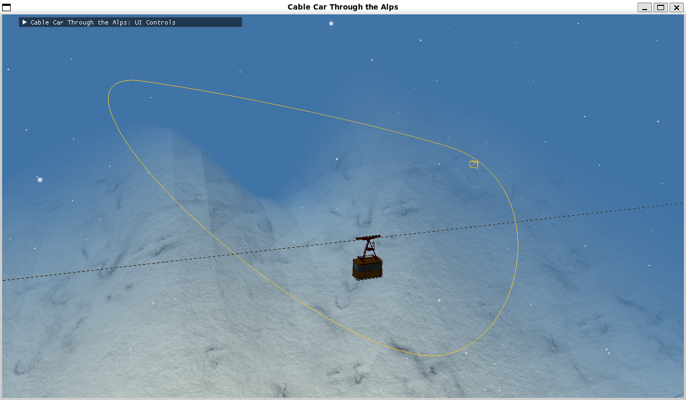
  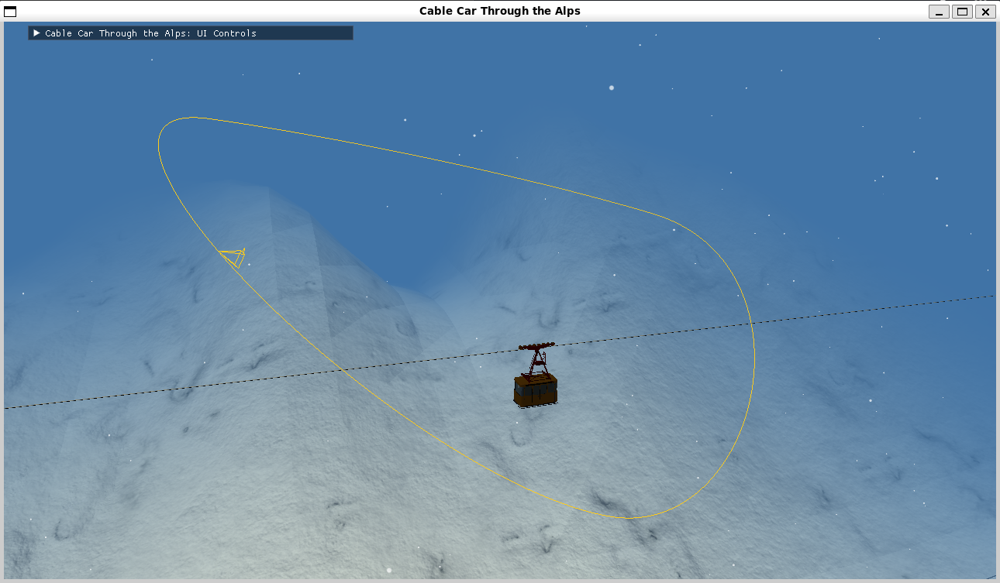

*Figure 12: Camera moving along the Bezier curve*

### Hierarchical transformations
The cable car has 3 moving parts: the doors, the door windows and the pulley wheels. The model did not initially have a proper component hierarchy. The components were coupled together based on material, not physical hierarchy. So I separated the doors, windows and pulley wheels all into separate components in Blender.  
The transformations are implemented using the `m_nodeWorldOffsets` table. The table keeps track of offsets for child components. This is used by the recursive `drawNode` function, which looks for offsets for the current node, applies them, and then draws each child node. Due to the recursive nature of `drawNode`, the transforms are performed in the correct order.  
The rotation of the pulley wheels is implemented similarly, however, the rotations need to be performed relative to the childs local origin. In addition to the transformation, `m_nodeRotations` contains the center parameter, which is the node's local origin. 
Setting the node rotation for a node includes finding the node's local origin, and calculating the transformation, which is translating it to the global origin, using the local origin, performing the rotation, and translating it back. `drawNode` uses this analogously. 
The pulley wheels spin at the speed specified in the GUI, the doors can be opened using a slider, and the windows can be toggled into a semi-open position (see Figures 13, 14). 

  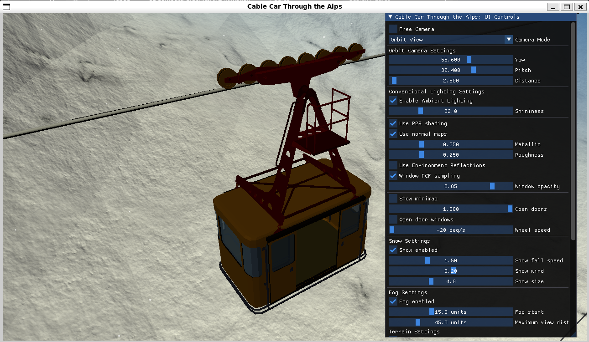

*Figure 13: Doors fully open*

  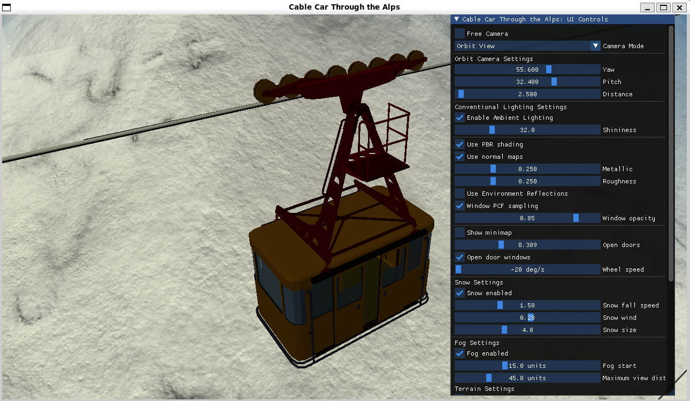

*Figure 14: Doors and windows semi open*

### Extra Features

#### Day-night system

This feature is implemented to seamlessly change the sky and light sources throughout the day.

##### Time of Day

 This slider controles the time of the day 0 is sunrise, 0.25 midday, 0.5 sunset, 0.75 midnight and back to one to transition back to sunrise. The sun moves around the scene on a circle, tilted a little along z so its path is not a straight line over the cable car. The moon is always on the opposite side of the sky.

<table>
  <tr>
    <td align="center">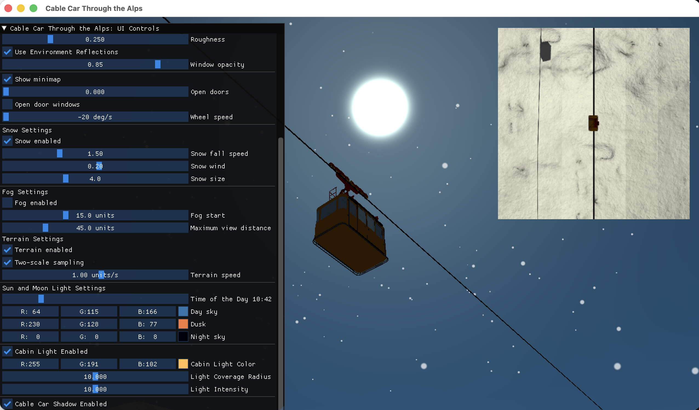</td>
    <td align="center">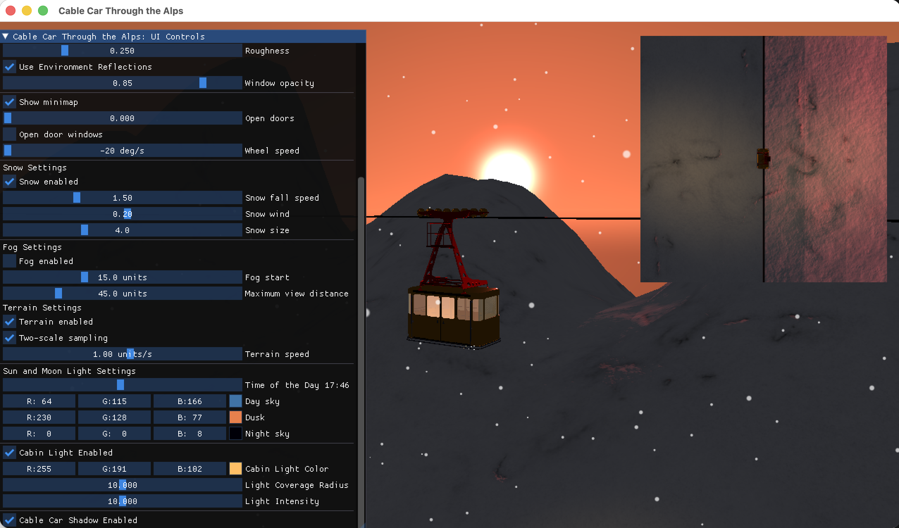</td>
    <td align="center">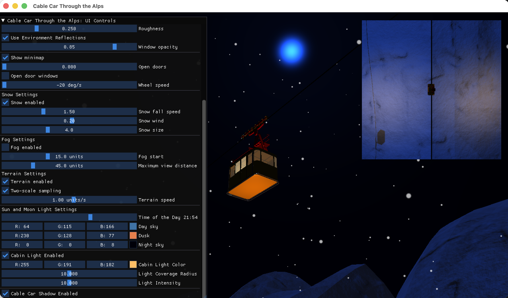</td>
  </tr>
  <tr>
    <td align="center">Sun at Noon</td>
    <td align="center">Sun at Dusk</td>
    <td align="center">Moon at Night</td>
  </tr>
</table>

*Figure 15: The sun and the moon in the sky at noon (left), sun at dusk (middle) and midnight (right), set with the "Time of the Day" slider. Fog is disabled*

The height of the sun decides everything. Low in the sky the sunlight is red (dusk), and it blends to a warm white as the sun rises. It then fades out completely as the sun goes below the horizon. The moon is now in the scene and it comes in as the sun goes down and gives a blue light. The ambient light is dark blue at night and brighter by day.

##### Sky

The sky colour comes from the same values, and the sky shader renders the sun and the moon as bright discs. Figure 16 shows the sky colours during different times of the day. The colours blend and transform seemlessly as we slide the timer in the UI.

<table>
  <tr>
    <td align="center">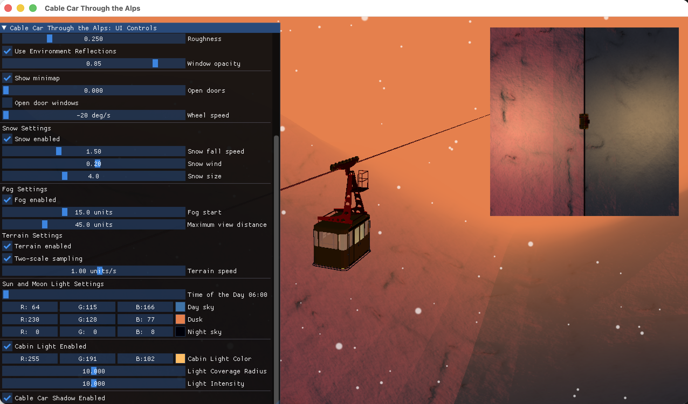</td>
    <td align="center">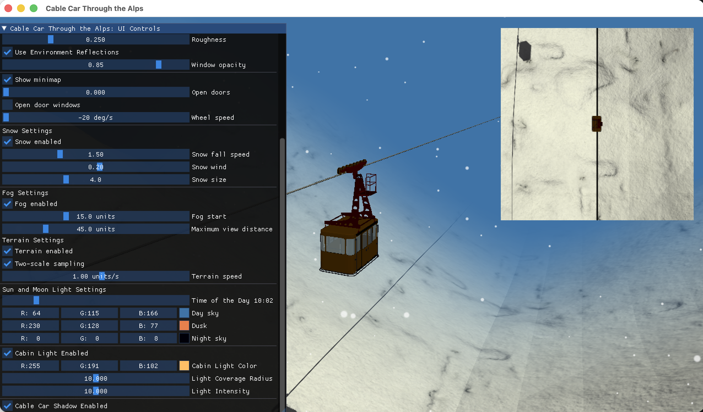</td>
    <td align="center">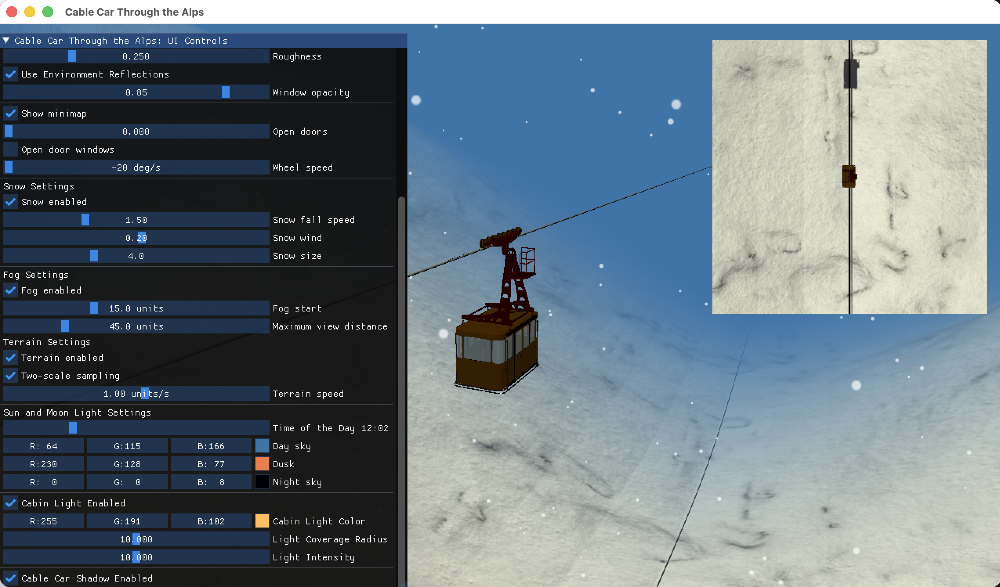</td>
  </tr>
  <tr>
    <td align="center">Sunrise</td>
    <td align="center">Morning</td>
    <td align="center">Midday</td>
  </tr>
  <tr>
    <td align="center">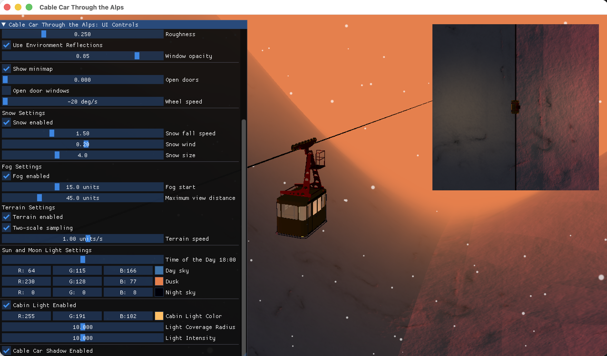</td>
    <td align="center">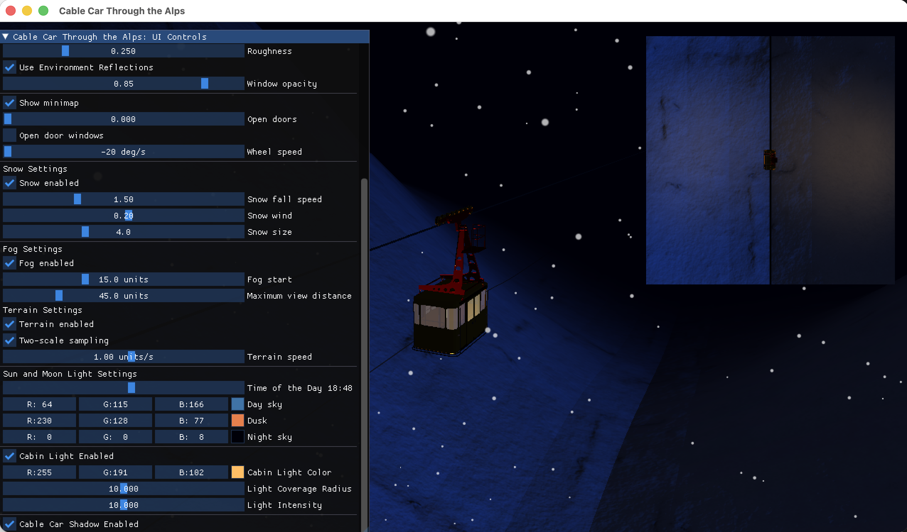</td>
    <td align="center">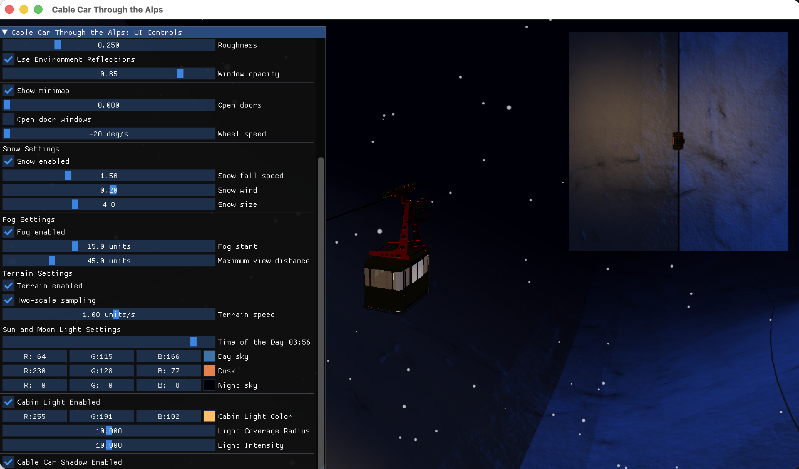</td>
  </tr>
  <tr>
    <td align="center">Sunset</td>
    <td align="center">Evening</td>
    <td align="center">Midnight</td>
  </tr>
</table>

*Figure 16: The same view at six times of day, updated with the "Time of the Day" slider in the UI. From left to right and top to bottom: sunrise, morning, midday, sunset, evening and midnight.*

----

### Cabin light
This feature is implemented to light up the cabin as the day gets darker.
* A warm lamp is placed inside the cabin, which is a point light that lights the cabin interior and the surfaces near it.
* It's value is controlled by the sun's height. So, it turns on as it gets dark. It is off in full daylight, lights up around sunset and is at full strength at night. 
* The light gets weaker with distance: (1 − distance / radius)². The radius, intensity and colour can be changed in the UI menu, and a checkbox switches it off.
* The windows also get a small extra glow to ensure that the cabin looks lit from the outside.
* In this project, the lamp light itself does not cast any shadows.

Figure 17 below shows the effect of cabin light and how the terrain looks when the area light covers and intensity of the light is increased.

<table>
  <tr>
    <td align="center">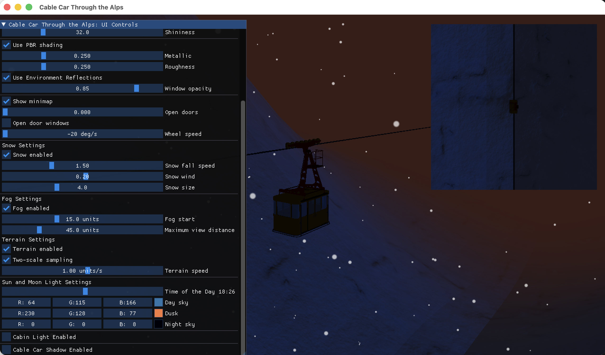</td>
    <td align="center">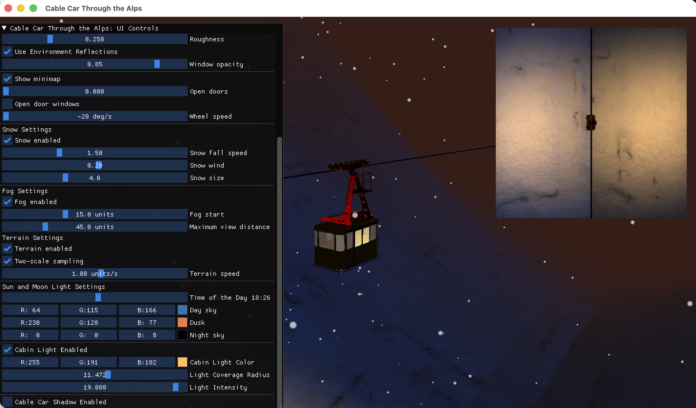</td>
  </tr>
  <tr>
    <td align="center">Cabin Light Disabled</td>
    <td align="center">Cabin Light Enabled</td>
  </tr>
  <tr>
    <td align="center">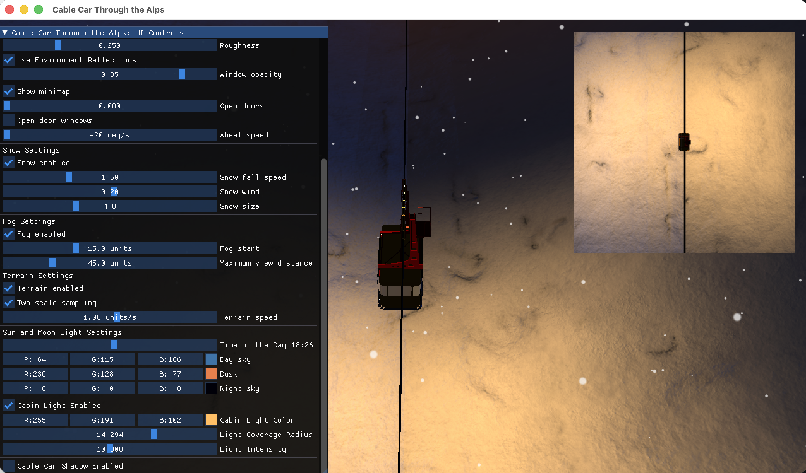</td>
    <td align="center">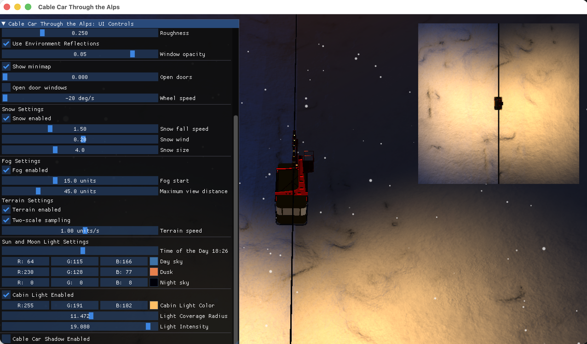</td>
  </tr>
  <tr>
    <td align="center">High Radius</td>
    <td align="center">High Intensity</td>
  </tr>
</table>

*Figure 17: The cabin light at night. Enabled and disabled (top row), and with a high radius and a high intensity (bottom row). Only the value named in each label differs from the default.*

----

### Shadows (Cable Car and Rope)

To add more realistic effects, a shadow map is implemented for both cable and the rope. This is, however, only with respect to the sun or moon. The cabin light has no impact on the shadow.
* **Cable Car shadow:** The cabin is drawn once from the light's point of view into a depth texture (a shadow map, 4096 × 4096). When the terrain is drawn, each point is compared with that depth: if something is closer to the light, the point is in shadow. The sun casts the shadow by day and the moon at night. For the scope of this project, only the cabin casts shadows and only the terrain receives them.
* **Soft Edges:** A 3 × 3 kernel of nearby samples (PCF) softens the edge, and a small bias avoids shadow acne on lit surfaces.
* **Low Sun:** At sunrise and sunset the sun is close to the horizon, which would make the cable car's shadow extremely long and go beyond the shadow map we have. To avoid this, the direction used for the shadow is clamped to 40° above the horizon. This has no impact on the lighting which will still use the real sun position.
* **Rope Shadow:** The rope's thickness was too low to show up clearly in a shadow map. To fix this, its shadow is computed directly in the terrain shader. For each terrain point, a line/ray is followed towards the light. If that line passes close to the rope, the point is cast as shadow, with a soft edge. Finally, the rope shadow and the cabin shadow are combined by taking the darker of the two values for each point. This means that a point is in shadow if either the cabin or the rope blocks the light, and it does not get darker if both do.

Figure 18 shows the shadows disabled, how it looks at noon when the sun is right above the cable car and how the shadows shift when the light source moves across the day.

<table>
  <tr>
    <td align="center">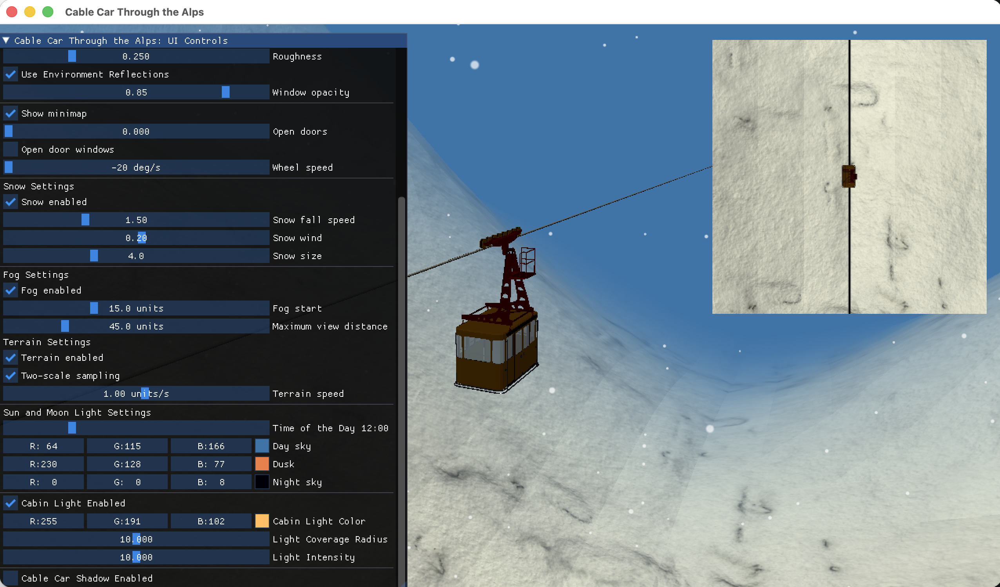</td>
    <td align="center">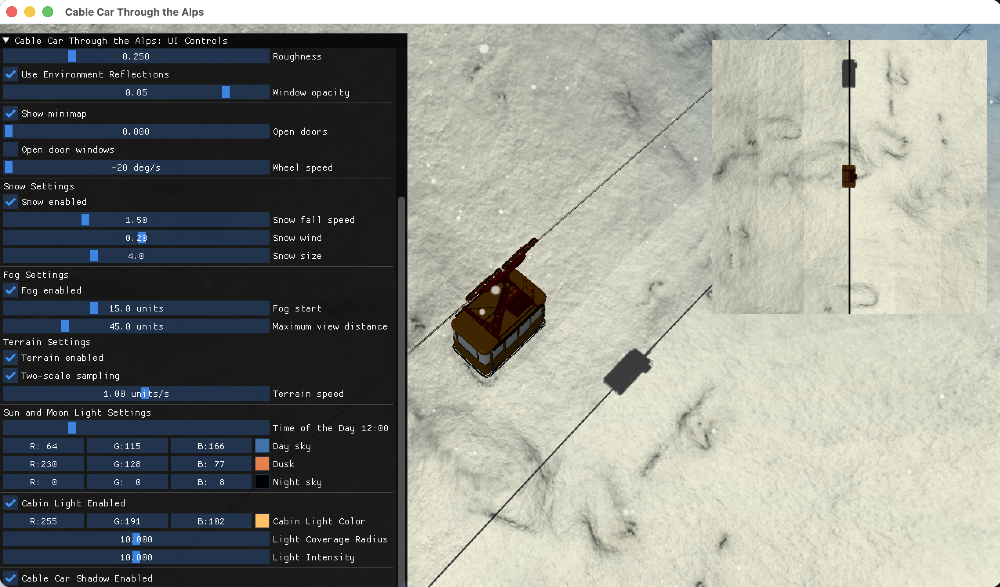</td>
  </tr>
  <tr>
    <td align="center">Shadows Disabled</td>
    <td align="center">Shadows at Noon</td>
  </tr>
  <tr>
    <td align="center">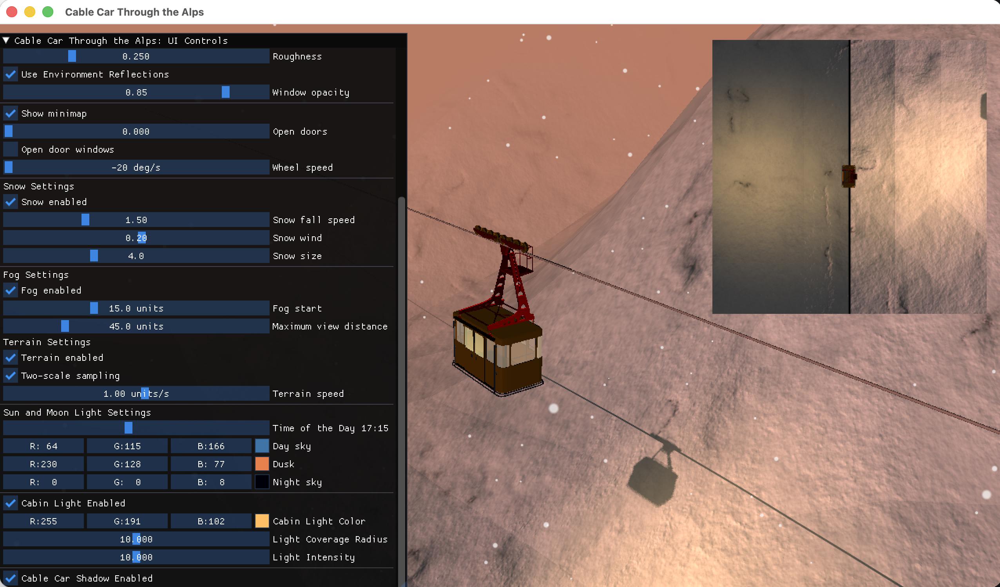</td>
    <td align="center">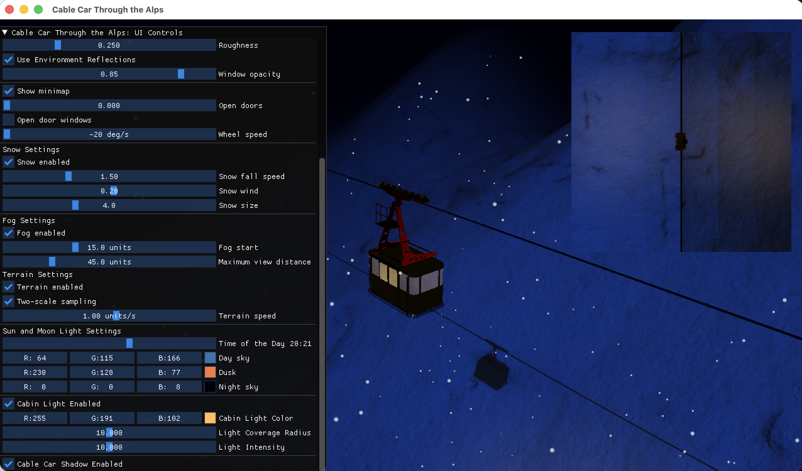</td>
  </tr>
  <tr>
    <td align="center">Shadows at Dusk</td>
    <td align="center">Shadows at Night</td>
  </tr>
</table>

*Figure 18: The cable car and rope shadow on the terrain with shadows disabled (top left), and enabled at noon (top right), dusk (bottom left) and night (bottom right). The shadow at night is cast by the moon.*

----

#### Minimap

A minimap is implemented to provide overview of the surrounding environment. It helps the user keep track of the cable car's position as it moves through the snow mountains. This is rendered separately from the main scene using OpenGL Framebuffer. 

It uses a **top-down camera (orthographic) position**, which is placed directly above the cable car. The minimap dynamically adjusts the position based on the cable car's current world position. This allows to keep the car centered in the minimap. 

This approach was selected as it allows the minimap to operate independently of the terrain and car. It provides the user with a continuous overview of the cable car's surroundings without changing the perspective of the main camera.

  

*Figure 19: Minimap* 

### Environment and 3D Model Setup

#### Cable Car:
The Cable Car model [[1](https://sketchfab.com/3d-models/cable-car-1621ec805f3b460faf50cd61f7bcb98f)] is a downloadable 3D model imported into the OpenGL project. It is integrated into the environment as the main object of the scene. It provides a cabin with supporting columns and pulley system for the cable. The model is slightly modified to fit the environment. 

However, the original model required some modifications to fit the requirements of the project. The support column and the pulley system needed to be adjusted so that the model could support the horizontal cable used in the scene. Blender was used to do these changes, where parts were repositioned and adjusted to achieve more suitable configuration.

  
  

*Figure 20: Original Cable Car Model (left) and Adjusted Model (right)*

#### Cable:
The cable is procedurally generated alongside with the Mountains using OpenGL rather than a separate imported model. It uses a cylindrical mesh consisting of 128 segments, with each of them having 8 vertices arranged in a ring. These rings are connected using triangles to form a continuous cable with small radius.
To support the looping terrain, three copies are rendered at different z-axis offsets. Their positions follow a terrain offset, which keeps the cable aligned with the looping terrain.

#### Mountain
**Current Mountain model**

The **Initial Mountain model** [[2](https://sketchfab.com/3d-models/mountain-range-01-6dff907d427f4c9f8d301075f8019c82)] was also a downloadable 3d model. This model was selected for its detailed geometry and realistic appearance.
Another important consideration was its support for normal mapping. Normal mapping enhances the surface detail of mountain and makes it appear more detailed without significant increase in geometric complexity.
However, this model didn't provide support for looping, which was important for creating an extended mountain landscape. Using it would have made it difficult to achieve this continuity, leaving gaps in the terrain.

  

*Figure 21: Initial Mountain Model Used* 

----

## ImGui Controls
| Input | Action |
|--------------------|--------|
| Free Camera | Switches to a free camera. WASD moves, Space and Ctrl move up and down, and left-drag looks around.|
| Camera Mode | Toggles between Orbit View, Top View, Follow View and Bezier View. |
| Yaw (Orbit view) | Rotates the camera around the cable car, around the vertical axis. |
| Pitch (Orbit view only) | Raises or lowers the camera's angle above the horizontal plane around the cabin. |
| Distance (Orbit view only) | Changes the radius of the orbit, i.e. how far the camera is from the cabin. |
| Loop distance | Controls the position along camera's Bezier path. |
| Loop speed | Controls the speed along camera's Bezier path. Reverses when the value is negative. |
| Draw Bezier curve (Bezier view only) | This checkbox decides whether the curve is drawn|
| Enable Ambient Lighting | Adds general illumination to the scene in the conventional (Blinn-Phong) shading. |
| Shininess | Controls the sharpness of the specular highlights in the conventional shading. |
| Use PBR shading | Switches the cabin body between PBR (Cook-Torrance) and conventional conventional (Blinn-Phong) shading. |
| Use normal maps | Switches terrain lighting to use the texture normal map instead of the mesh normals |
| Metallic (PBR only) | Controls how much the surface behave like a metal. |
| Roughness (PBR only) | Controls how much roughness spreads and dims the highlight. |
| Use Environment Reflections | Displays the window reflections of the surroundings when enabled. |
| Window PCF sampling | Toggle whether to use PCF to blend the window reflection | 
| Window opacity | Sets how transparent the cabin windows are. |
| Show minimap | Shows or hides the minimap window. |
| Open doors | Slides the doors open when enabled. |
|Open door windows | Slides the door windows open when enabled. |
| Wheel speed | Rotation speed of the pulley wheels in degrees per second; reverses when negative. |
| Snow enabled | Checkbox to enable snow fall. |
| Snow fall speed | Slider to determine the speed of snow fall when enabled. |
| Snow wind | Slider to determine the direction of snow fall when influenced by wind. |
| Snow size |Slider to determine how large the snowflakes are. |
| Fog enabled | Turns fog on and off. |
| Fog start | Determines the distance from where the fog starts. |
| Maximum view distance | Distance where objects begin to disappear when fog starts. |
| Terrain enabled | Turns the terrain on and off. |
| Two-scale blending | Blends two texture scales for less visible repetition when enabled. |
| Terrain speed | Sets how fast the terrain scrolls; reverses when negative. |
| Time of the Day | Sets the time of day. It also displays a clock time: 0 is 06:00 (sunrise), 0.25 is 12:00 (midday), 0.5 is 18:00 (sunset) and 0.75 is 00:00 (midnight). |
| Day sky | Colours of the sky during the day. |
| Dusk | Colours of the sky at dusk. |
| Night sky | Colours of the sky at night. |
| Cabin Light Enabled | Turns the cabin light on and off. |
| Light Color (Cabin Light) | The colour of the lamp can be picked here. |
| Light Coverage Radius (Cabin Light) | To set how far its light reaches
| Light Intensity (Cabin Light) | To set how and how strong it is. |
| Cable Car Shadow Enabled | Turns the cabin and rope shadows on and off. |

### Snowfall
In the project, we also have a snowfall particle effect (see Figures 22, 23). The particle effect is created within a box around the cable car. Particles instantiated in random locations around the box with random sizes. A particle is essentially a `vec4`, which contains its position in the x, y and z parameters, and size in the w parameter. They are drawn to on the screen using `GL_POINTS`. 
The particles horizontal displacement is dependent on wind speed and vertical displacement on the fall speed. When a particle goes outside the box, it is reset to the top. The particles are shaded as circles with the outline fading into transparency. `snow.vert` defines the `edgeFade` parameter based on the position of the particle. If the particle is nearing an edge, it starts fading. This makes it so the snowflakes smoothly appear and disappear at the edges. 

  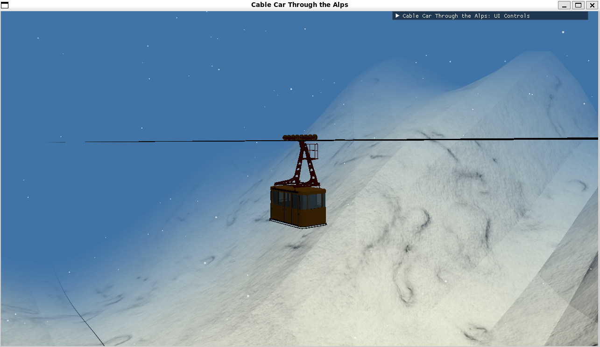

*Figure 22: Light snow*

  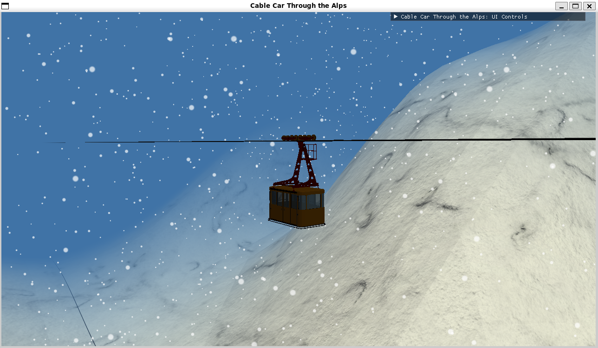

*Figure 23: Heavy snow*

### Fog 
To conceal the terrain resets and limited background geometry, we implemented a fog post processing effect. First the scene is rendered, then distant pixels are faded, creating a foggy effect.  
`Fog::begin` creates a frame buffer that stores the scene's color and depth. Then `fog.frag` reads the pixel's depth, and uses the inverse projection matrix to find its distance from the camera. Then we calculate the fog amount based on the distance from the camera, and blend the scene color together with the fog color. For the fog color, we use the sky's color. Different levels of fog are shown in Figures 14-16.

  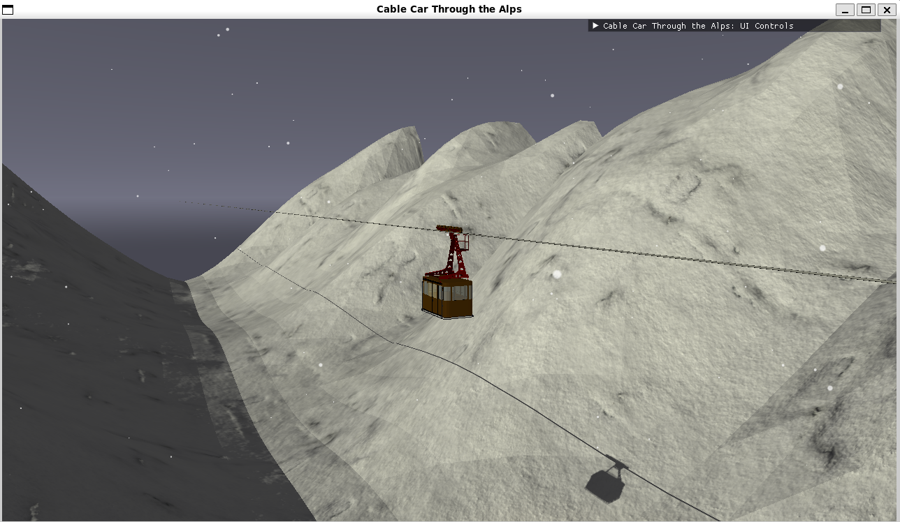

*Figure 24: No fog*

  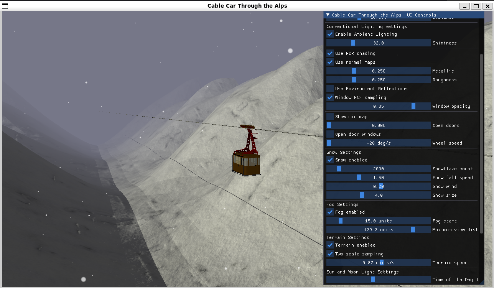

*Figure 25: Light fog*

  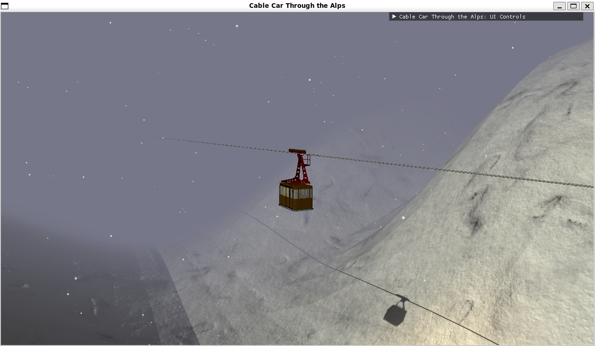

*Figure 26: Dense fog*

## References
[1] https://sketchfab.com/3d-models/cable-car-1621ec805f3b460faf50cd61f7bcb98f

[2] https://sketchfab.com/3d-models/mountain-range-01-6dff907d427f4c9f8d301075f8019c82

[3] https://stackoverflow.com/questions/4770735/shader-sun-position-glsl - idea taken for moving sun
[4] https://community.khronos.org/t/day-night-cycle-light/57752- inspiration taken for sunlight affecting sky color
[5] https://github.com/ocornut/imgui/issues/4213- discussions referred for imgui controls
[6] https://learnopengl.com/PBR/Theory- formula for pbr shaders (also in lecture slides)
[7] https://learnopengl.com/Advanced-OpenGL/Cubemaps- to understand cubemaps for environment mapping
[8] https://medium.com/@arda.yildirim158/environment-mapping-ceng469-hw2-eaeb3745f137- for environment mapping, used a discussion from this
[9] https://polyhaven.com/a/snow_02 - this is public domain, no credit necessary
[10] https://www.versluis.com/2023/05/how-to-use-macro-variations-for-unreal-engine-landscape-materials/
