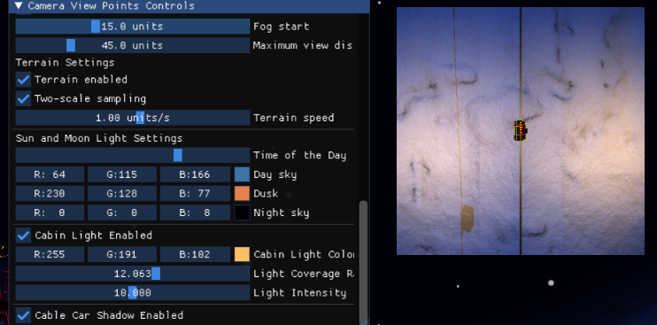

# Cable Car Through the Alps

[One-line description, e.g. "A real-time OpenGL tech demo of a cable car travelling through a snowy mountain landscape."]

## Team Members
| Name  | Main Contributions |
|-------|--------------------|
| Srinitish Ramesh |Material Textures and Lighting, Minimap (Top-Down View), Cable Car Model Adjustments and Import, Cable path for Cable Car, Mountain Import and Normal Mapping (Initial Version)   |
| Shreya Balaji | Multiple View Points (Orbit view, Top View, Follow View), PBR Shading, Environment Mapping, Day and Night (Light and Sky Settings), Cabin Lights, Cable Car and Rope Shadow   |
| [Name]|[contributions]     |

## Introduction

The demo is a real-time application written in C++ with OpenGL 4.1. It is built with CMake, and also uses ImGui for the control panel (to control all features from the UI) and Assimp to load the cable car model. 

The sections below describe the implemented features. The minimal features are described first, followed by the extra features. Each feature has a short explanation of the idea used to implement it, contributions by the team member, and screenshots. A table of all keys and sliders is given in *ImGui Controls*, so every screenshot can be reproduced exactly.

## Features

### Minimal features

#### Multiple View Points (Orbit View, Follow View, Top View): (Shreya Balaji)
The project uses multiple camera modes to follow the path of the cable car and also view the snowy terrain around it. 
* Orbit View: This view (as depicted in Figure 1) is used to orbit around the cable car. This is controlled by yaw, pitch and distance which can control angle around the vertical axis, angle above the horizontal axis and radius of the orbit. Pitch is limited to -85 degrees to +85 degrees to ensure the view doesn't look down exactly and flip. The minimum distance is also kept at 2 units to ensure that we don't really go into the cable car.

![[Orbit View]](Figures/orbit_view.png)
*Figure 1: Orbit View*

* Top View: The camera hangs about 12 units above the targeted cable car and looks straight down, which gives a top view. Figure 2 shows an over view of this. Also, GLM's lookAt computes the camera's right axis as the cross product of the looking direction and the up vector (0,1,0). If the camera looks exactly down, these two are parallel making the cross product zero; hence a small offset of 0.01 is added along z, which makes them slightly non-parallel without changing the view entirely.

![[Top View]](Figures/top_view.png)
*Figure 2: Top View*

* Follow View: The camera basically follows the cable car along the rope; it keeps a fixed offset which is 2.5 units up and 8 units away along the z axis. This is depicted in Figure 3 below.

![[Follow View]](Figures/follow_view.png)
*Figure 3: Follow View*

#### Material Textures and Lighting
Material Textures and Lighting models are implemented in this demo to showcase how the body of Cable Car interacts with light. The diffuse coefficient **(kd)** and specular coefficient **(ks)** are used to showcase the base color and highlights of the model. **Shininess** is also integrated to determine the level of sharpness of these highlights.

To provide shading based on the angle in which light hits the surface, **Lambertian Diffuse Reflection** is used. To produce more realistic reflective surface **Blinn-Phong Specular reflection** is added. Finally, **Ambient Lighting** provides general illumination, ensuring that the surface is visible in areas that lack direct lighting.

*Note:* These material, texture, and conventional lighting features are implemented to fulfill the assignment's minimal requirements. However, the team has decided to use **Physically Based Rendering (PBR)** with metallic and roughness, to visually enhance the cable car model.

  
*Figure 4: Conventional Lighting Settings Not Enabled* 

  
*Figure 5: Conventional Lighting Settings Enabled*

#### 
### Extra Features
#### Minimap
A minimap is implemented to provide overview of the surrounding environment. It helps the user keep track of the cable car's position as it moves through the snow mountains. This is rendered separately from the main scene using OpenGL Framebuffer. 

It uses a **top-down camera (orthographic) position**, which is placed directly above the cable car. The minimap dynamically adjusts the position based on the cable car's current world position. This allows to keep the car centered in the minimap. 

This approach was selected as it allows the minimap to operate independently of the terrain and car. It provides the user with a continuous overview of the cable car's surroundings without changing the perspective of the main camera.

  
*Figure 6 Minimap* 
### ImGui Controls
| Input / UI element | Action |
|--------------------|--------|
| [key or slider] | [what it does] |
| Enable Ambient Lighting | This key adds general illumination to the scene.|
| Shininess Slider | Controls the sharpness of specular highlights. |
| Show Minimap | Enables or Disables the Minimap window in the UI. |

### Environment and 3D Model Setup

#### Cable Car:
The Cable Car model [[1](https://sketchfab.com/3d-models/cable-car-1621ec805f3b460faf50cd61f7bcb98f)] is a downloadable 3D model imported into the OpenGL project. It is integrated into the environment as the main object of the scene. It provides a cabin with supporting columns and pulley system for the cable. The model is slightly modified to fit the environment. 

However, the original model required some modifications to fit the requirements of the project. The support column and the pulley system needed to be adjusted so that the model could support the horizontal cable used in the scene. Blender was used to do these changes, where parts were repositioned and adjusted to achieve more suitable configuration.

  
*Figure 6: Original Cable Car Model* 

  
*Figure 7: Adjusted Model*

#### Cable:
The cable is procedurally generated alongside with the Mountains using OpenGL rather than a separate imported model. It uses a cylindrical mesh consisting of 128 segments, with each of them having 8 vertices arranged in a ring. These rings are connected using triangles to form a continuous cable with small radius.
To support the looping terrain, three copies are rendered at different z-axis offsets. Their positions follow a terrain offset, which keeps the cable aligned with the looping terrain.

#### Mountain
**Current Mountain model**

The **Initial Mountain model** [[2](https://sketchfab.com/3d-models/mountain-range-01-6dff907d427f4c9f8d301075f8019c82)] was also a downloadable 3d model. This model was selected for its detailed geometry and realistic appearance.
Another important consideration was its support for normal mapping. Normal mapping enhances the surface detail of mountain and makes it appear more detailed without significant increase in geometric complexity.
However, this model didn't provide support for looping, which was important for creating an extended mountain landscape. Using it would have made it difficult to achieve this continuity, leaving gaps in the terrain.

*Figure 8 : Initial Mountain Model Used* 

## References
[1] https://sketchfab.com/3d-models/cable-car-1621ec805f3b460faf50cd61f7bcb98f

[2] https://sketchfab.com/3d-models/mountain-range-01-6dff907d427f4c9f8d301075f8019c82

[3] https://stackoverflow.com/questions/4770735/shader-sun-position-glsl - idea taken for moving sun

[4] https://community.khronos.org/t/day-night-cycle-light/57752 - inspiration taken for sunlight affecting sky color

[5] https://github.com/ocornut/imgui/issues/4213 - discussions referred for imgui controls

[6] https://learnopengl.com/PBR/Theory - formula for pbr shaders (also in lecture slides)

[7] https://learnopengl.com/Advanced-OpenGL/Cubemaps - to understand cubemaps for environment mapping

[8] https://medium.com/@arda.yildirim158/environment-mapping-ceng469-hw2-eaeb3745f137 - for environment mapping, used a discussion from this