# Cable Car Through the Alps

**Cable Car Through the Alps** is a C++/OpenGL project developed by our team: it features an endlessly scrolling cable car ride through a snowy mountain landscape. The viewer can follow the cable car from several camera viewpoints, change the time of day, and adjust the lighting and materials live from a control panel. The scene is enhanced by an animated cable car (opening doors and turning wheels), a rope, falling snow and fog.

This report gives an overview of the implemented features, along with screenshots. Each team member's contribution is summarised, and described alongside the features they implemented.

The project applies the concepts taught in the lectures of 3D Computer Graphics and Animation. Knowledge from additional external sources is listed in the references.

## Team Members
| Name  | Main Contributions |
|-------|--------------------|
| Srinitish Ramesh |Material Textures and Lighting, Cable Car Model Adjustments and Import, Cable path for Cable Car, Mountain Import and Normal Mapping (Initial Version)   |
| Shreya Balaji | Multiple View Points (Orbit view, Top View, Follow View), PBR Shading, Environment Mapping (applied to whole cabin initially, optimized by Henrik later), Day and Night (Light and Sky Settings), Cabin Lights, Cable Car and Rope Shadow   |
| [Name]|[contributions]     |

## Introduction

The demo is a real-time application written in C++ with OpenGL 4.1. It is built with CMake, and also uses ImGui for the control panel (to control all features from the UI) and Assimp to load the cable car model. 

The sections below describe the implemented features. The minimal features are described first, followed by the extra features. Each feature has a short explanation of the idea used to implement it, contributions by the team member, and screenshots. A table of all keys and sliders is given in *ImGui Controls*, so every screenshot can be reproduced exactly.

## Features
### Minimal features

#### Multiple View Points (Orbit View, Follow View, Top View)
The project uses multiple camera modes to follow the path of the cable car and also view the snowy terrain around it. 

##### Orbit View
This view (as depicted in Figure 1) is used to orbit around the cable car. This is controlled by yaw, pitch and distance which can control angle around the vertical axis, angle above the horizontal axis and radius of the orbit. Pitch is limited to -85 degrees to +85 degrees to ensure the view doesn't look down exactly and flip. The minimum distance is also kept at 2 units to ensure that we don't really go into the cable car.

  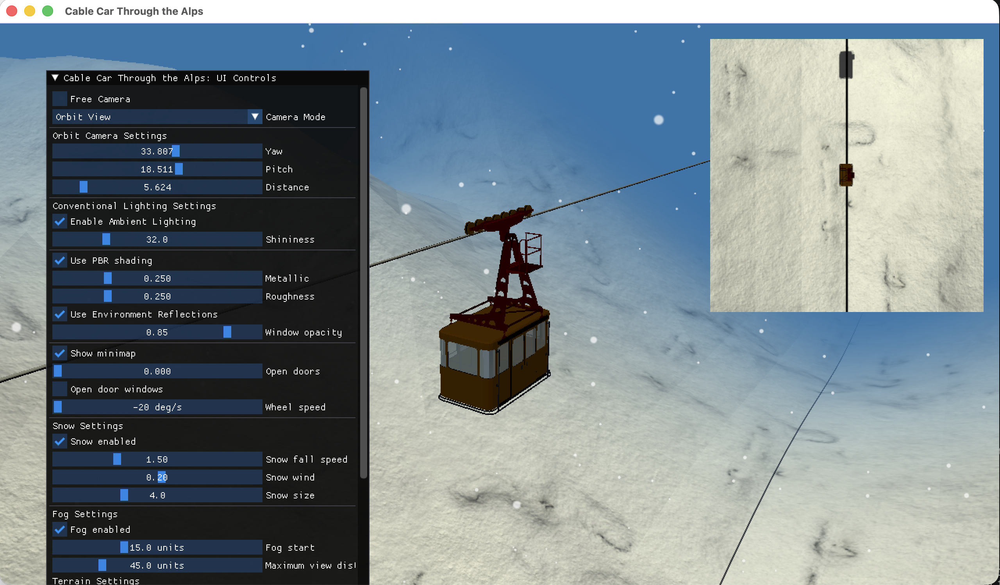

*Figure 1: Orbit View*

##### Top View
The camera hangs about 12 units above the targeted cable car and looks straight down, which gives a top view. Figure 2 shows an over view of this. Also, GLM's lookAt computes the camera's right axis as the cross product of the looking direction and the up vector (0,1,0). If the camera looks exactly down, these two are parallel making the cross product zero; hence a small offset of 0.01 is added along z, which makes them slightly non-parallel without changing the view entirely.

  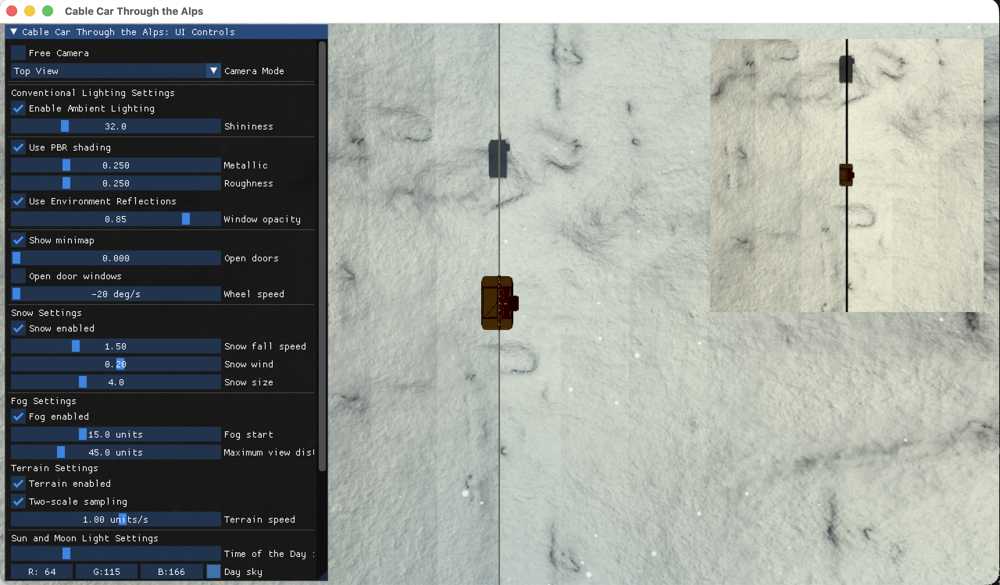

*Figure 2: Top View*

##### Follow View
The camera basically follows the cable car along the rope; it keeps a fixed offset which is 2.5 units up and 8 units away along the z axis. This is depicted in Figure 3 below.

  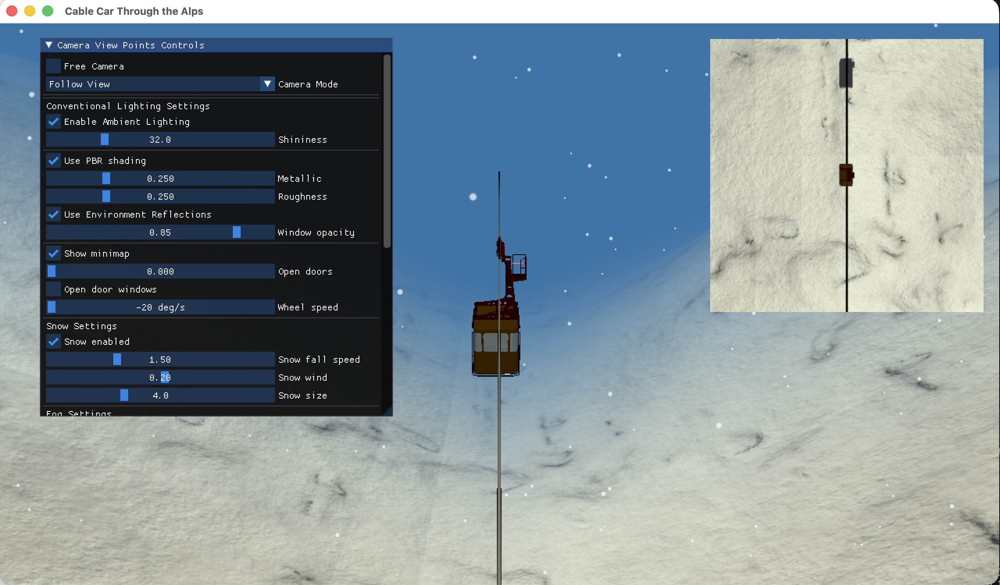

*Figure 3: Follow View*

----

#### PBR Shading
When the PBR Shading is enabled, the body of cable car uses Cook-Torrance microfacet model instead of the Blinn-Phong shader. This is used to compute how much light is reflected off the surface. Two sliders are provided to control metallic and roughness. A dull highlight is given for high roughness; metallic value basically increases the ability's surface to display properties of a metal.

For all light sources (sun, moon and a cabin light in our case), a function is defined to compute the reflected light from the parts of the cable car. The computed value is added to the ambient term.

The Cook-Torrance microfacet model is implemented for this. Some external sources and lecture content were used to gain better understanding of this can be implemented and these are added in the reference.

* **D (GGX Distribution):** It control how large and how sharp the shiny spot is. With low roughness, the cabin gets a small, bright, highlight and with high roughness, the highlight spreads into a dim and dull, matte surface.

* **G (Smith with Schlick-GGX):** It reduces the highlight where the surface is seen at a smaller angle; basically reduces light when viewed from a grazing angle.

* **F (Fresnel Term, Schlick approximation):** This gives surfaces more mirror-like appearance at grazing angles. On the cabin, this gives a brighter appearance along the edges and on surfaces seen from the side.

* **F0 (Base Reflectance):** This is indicative of how reflective the surface is when looked directly at it. As the metallic value increases, surface begins to look more like a metal because of this base reflectance value.

* **Specular Term:** This combines D, G and F (D · G · F / (4 · N·V · N·L)) into the shiny part of the surface, which is what gives the cabin its highlights and reflections. Because it uses all three terms, the highlight combines roughness, viewing angle and metallic value together, making the cabin look more metallic when metallic value is increased.

* **Diffuse Term:** This is the matte colour of the cabin and it is reduced by the Fresnel and the metallic value kD, so as the surface becomes more metallic it loses its matte colour and depends on its reflections, similar to what an actual metal does. It is also divided by π so the surface never reflects more light than it receives (energy conservation, but also makes the brightness realistic).

  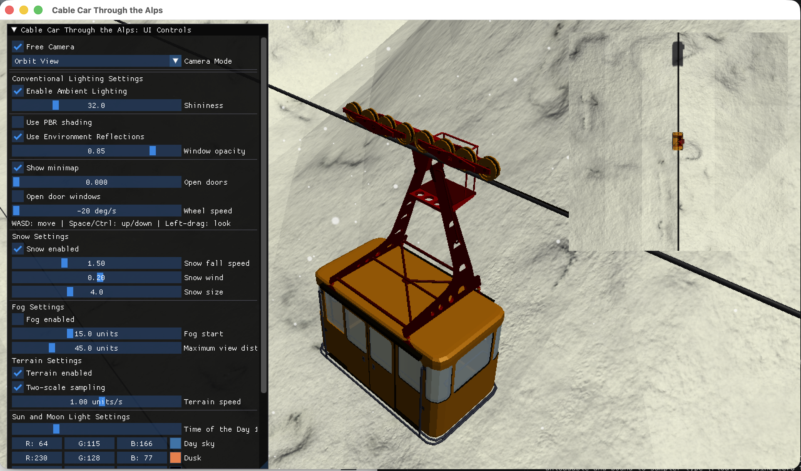
  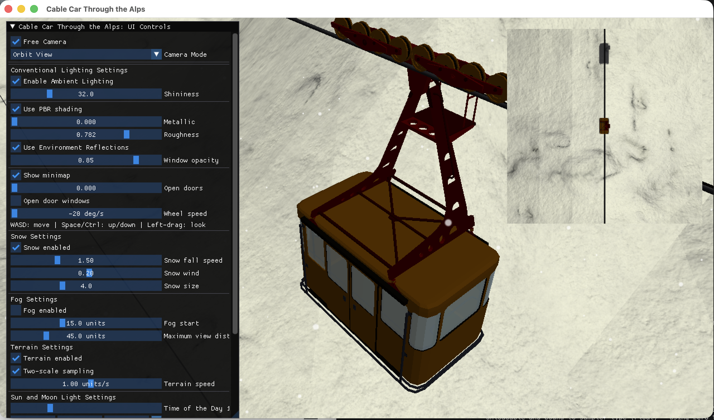

*Figure 4.* The cable car with PBR shading off (left, Blinn-Phong) and on (right, metallic 0.25, roughness 0.25). 

  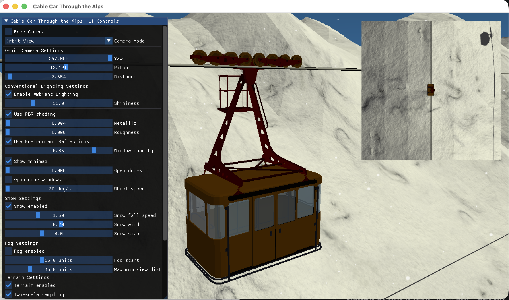
  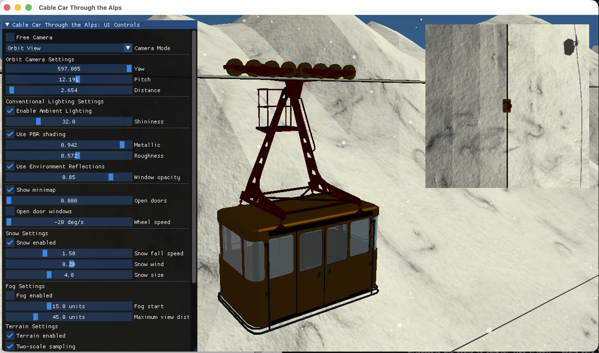

*Figure 5.* The cable car with metallic 0.00 / roughness 0.00 (left) and metallic 0.94 / roughness 0.57 (right). 

As it can be observed in Figure 4., with Blinn-Phong (left), the cabin roof and the red tower look bright and saturated. With PBR (right), the same surfaces look duller and darker. 

In Figure 5, the metallic and roughness values are slided from low to high. At the higher metallic value, the red tower loses its bright matte paint colour and looks darker. Since the diffuse term is lower, a metal shows only its reflections. With a metallic value of 0 and a roughness of 0, the surface keeps its full paint colour.

The two sliders change the look of the cable car in the way the model predicts: metallic controls how much matte colour remains, and roughness controls how wide and strong the highlight is. In these views the highlight is probably not very easy to see, because the cabin does not directly face the sun. Ensure to have fog disabled as well while running the application.

----

#### Material Textures and Lighting
Material Textures and Lighting models are implemented in this demo to showcase how the body of Cable Car interacts with light. The diffuse coefficient **(kd)** and specular coefficient **(ks)** are used to showcase the base color and highlights of the model. **Shininess** is also integrated to determine the level of sharpness of these highlights.

To provide shading based on the angle in which light hits the surface, **Lambertian Diffuse Reflection** is used. To produce more realistic reflective surface **Blinn-Phong Specular reflection** is added. Finally, **Ambient Lighting** provides general illumination, ensuring that the surface is visible in areas that lack direct lighting. To test this, toggle **Enable Ambient Lighting** on and off to observe general illumination. Adjust the **Shininess** slider to see how specular highlights changes.

*Note:* These material, texture, and conventional lighting features are implemented to fulfill the assignment's minimal requirements. However, the team has decided to use **Physically Based Rendering (PBR)** with metallic and roughness, to visually enhance the cable car model.

  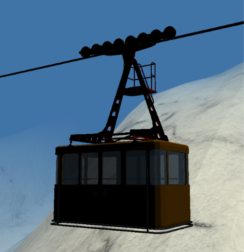
  

*Figure 6: Conventional Lighting Settings Not Enabled (left) and Conventional Lighting Settings Enabled (right)*

### Environment Mapping
Environment mapping lets the cabin windows reflect their surroundings, a snowy terrain in our case. 
The basic idea is that the cabin takes a picture of sorts in all direction and each window shows a part of that picture that a surface like mirror would reflect towards the viewing direction.

For our implementation, the sky and terrain is rendered six time in all directions into a cube map. A blurrier mip is also built from it for less shiny surfaces. To keep it almost real-time, it is captured for about 20 times per second. The view direction is mirrored and then used to look up the cube map, which gives the colour of the reflected sky and terrain. Figure 6 depicts the environment mapping enabled and disabled scenarios in our application.

  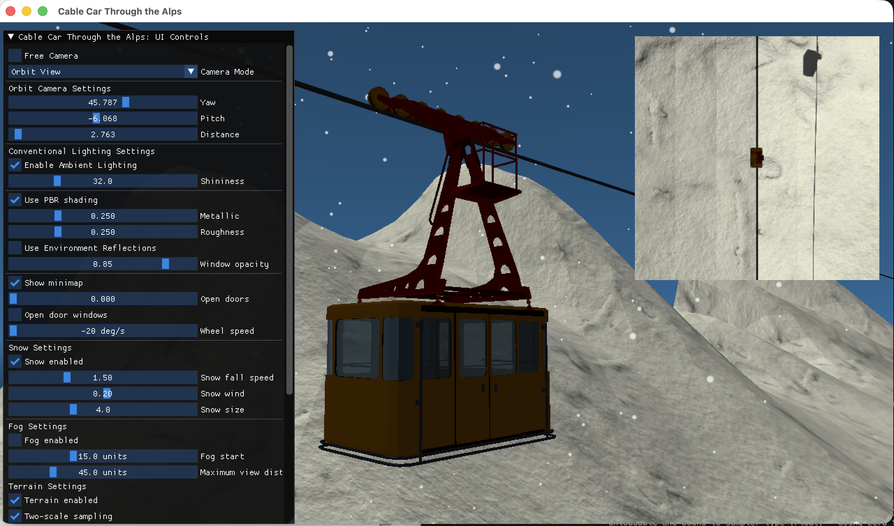
  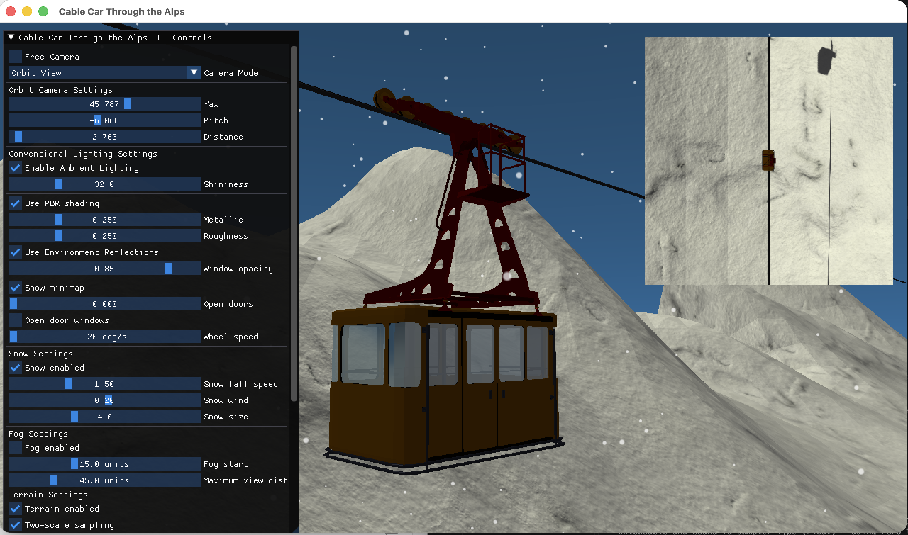

*Figure 7: Environment Mapping Disabled (left) and Environment Mapping Enabled (right)*

**Note:** The initial version of the environment mapping was applied to the whole cabin. The initial version of the environment mapping was applied to the whole cabin. Henrik later restricted it to the windows, reduced the capture rate, and added a lighter terrain draw for the capture.

#### 
### Extra Features

### ImGui Controls
| Input / UI element | Action |
|--------------------|--------|
| [key or slider] | [what it does] |

### Environment and 3D Model Setup

#### Cable Car:
The Cable Car model [[1](https://sketchfab.com/3d-models/cable-car-1621ec805f3b460faf50cd61f7bcb98f)] is a downloadable 3D model imported into the OpenGL project. It is integrated into the environment as the main object of the scene. It provides a cabin with supporting columns and pulley system for the cable. The model is slightly modified to fit the context. Blender was used to adjust the support column and pulley system, so that horizontal cable can be fit with the model. 

  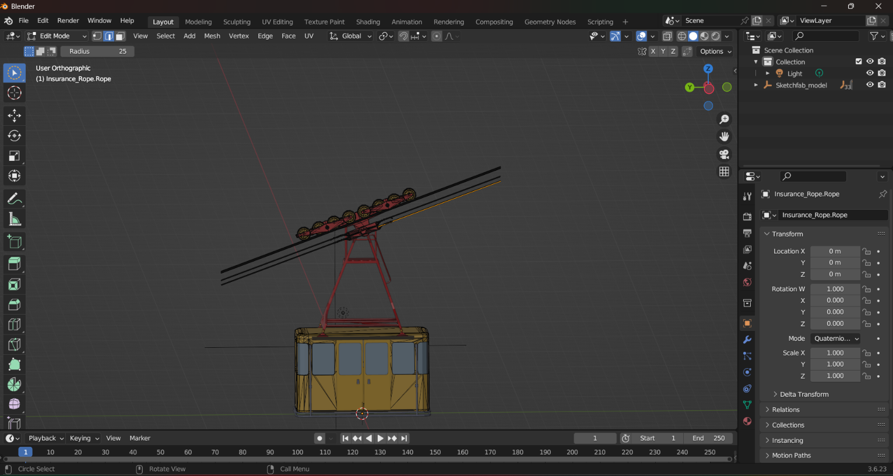
  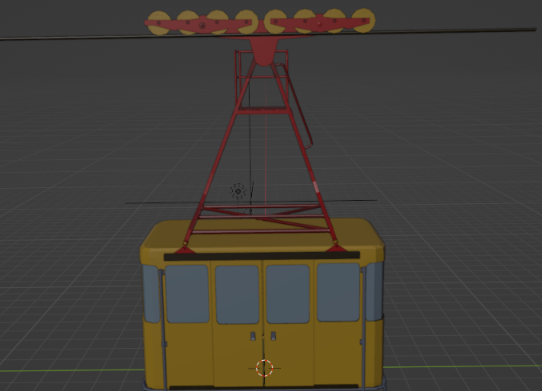

*Figure 8: Original Cable Car Model (left) and Adjusted Model (right) *

#### Mountain
**Current Mountain model**

The **Initial Mountain model** [[2](https://sketchfab.com/3d-models/mountain-range-01-6dff907d427f4c9f8d301075f8019c82)] was also a downloadable 3d model. This model was selected for its detailed geometry and realistic appearance, as well as its support for normal mapping. However, this model didn't provide support for looping, which was important for creating an extended mountain landscape.

  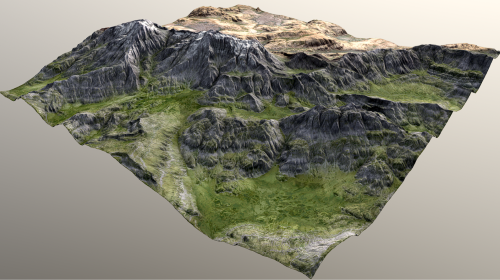

*Figure 9: Initial Mountain Model Used* 

## References
[1] https://sketchfab.com/3d-models/cable-car-1621ec805f3b460faf50cd61f7bcb98f
[2] https://sketchfab.com/3d-models/mountain-range-01-6dff907d427f4c9f8d301075f8019c82
[3] https://stackoverflow.com/questions/4770735/shader-sun-position-glsl - idea taken for moving sun
[4] https://community.khronos.org/t/day-night-cycle-light/57752- inspiration taken for sunlight affecting sky color
[5] https://github.com/ocornut/imgui/issues/4213- discussions referred for imgui controls
[6] https://learnopengl.com/PBR/Theory- formula for pbr shaders (also in lecture slides)
[7] https://learnopengl.com/Advanced-OpenGL/Cubemaps- to understand cubemaps for environment mapping
[8] https://medium.com/@arda.yildirim158/environment-mapping-ceng469-hw2-eaeb3745f137- for environment mapping, used a discussion from this